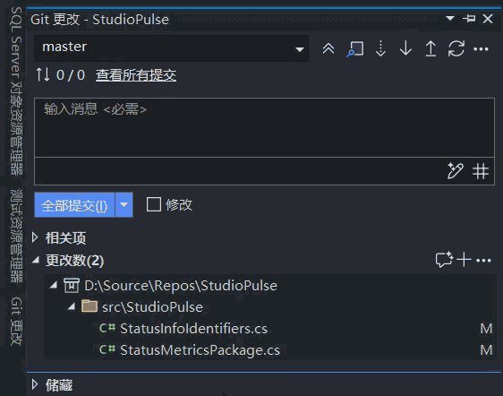

[](https://dotnet.microsoft.com/download/dotnet-framework)
[](https://learn.microsoft.com/en-us/dotnet/desktop/wpf/)
[](https://www.microsoft.com/windows)

# Git Changes Toolbox · [简体中文](README.zh-CN.md)



Git Changes Toolbox is a Visual Studio 2022 extension that adds two toolbar buttons to the Git Changes window: collapse or expand the change tree in one click, and locate the file you are currently editing.

## Features

- Collapse: folds every expanded folder in the change list
- Expand: click the same button again in the collapsed state to expand all folders; the icon and tooltip switch with the state
- Locate: reads the active document path, expands its parent folders, selects the file and scrolls it into view
- Shows a status bar message when the current file is not in the change list
- Buttons use Visual Studio theme icons and a borderless hover style, inserted right before the Commit All button

## Requirements

- Visual Studio 2022 (17.x, 64-bit)
- .NET Framework 4.7.2 or later
- Windows

## Installation

Close Visual Studio, double-click `GitChangesToolbox.vsix` in the publish folder, and choose the target Visual Studio instance in the VSIX Installer. Restart Visual Studio after installation.

## Usage

Open View → Git Changes. Two icon buttons appear right before the Commit All button:

| Button | Behavior |
| --- | --- |
| Collapse / Expand | Collapses all folders when expanded; expands all when collapsed |
| Locate | Expands the tree and selects the active file |

The collapse button's icon and tooltip change with the state.

## Build and publish

From VS2022 Developer PowerShell:

```powershell
$ErrorActionPreference = 'Stop'
msbuild src\GitChangesToolbox\GitChangesToolbox.csproj /restore /p:Configuration=Release
```

Or run the publish script:

```powershell
$ErrorActionPreference = 'Stop'
& .\scripts\Publish.ps1
```

The artifact is:

```text
publish\GitChangesToolbox.vsix
```

## How it works

Visual Studio exposes no extension point for the Git Changes window, so the extension reaches into its internal WPF control tree through reflection:

- Enumerates tool windows with `IVsUIShell.GetToolWindowEnum` and identifies the target window by the `GitToolWindow` type name
- The change list lives in `IndentedItemListView` inside `FileListView`, with data items of type `GitPendingChangeNode`
- Collapse and expand invoke the owning ViewModel's `ExpanderCommand` so the list rebuilds itself
- Locate matches the node's `ItemPath` against the document path, expands ancestors one level at a time, then sets the selection and calls `ScrollIntoView`
- Buttons are injected before the Commit All button, falling back to the top toolbar's `buttonPanel`

All access to internal types goes through reflection; `Microsoft.TeamFoundation.Git.Controls.dll` is never referenced directly.

## Known limitations

- Depends on internal Visual Studio controls and type names; a VS upgrade that changes the structure requires updating the reflection code
- Only targets Visual Studio 2022 17.x
- Buttons are injected at runtime and re-added by a timer after the window content is rebuilt

## Version

Current version: 1.7