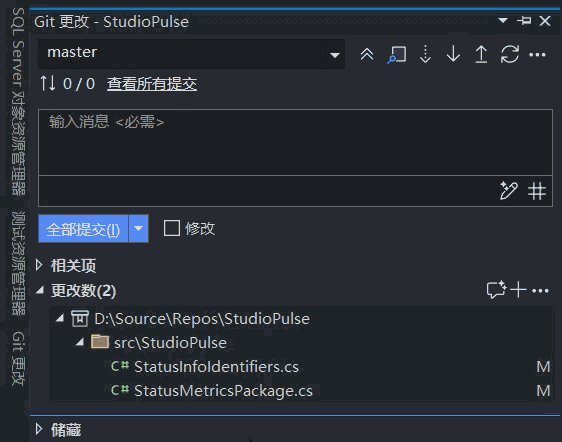

[](https://dotnet.microsoft.com/download/dotnet-framework)
[](https://learn.microsoft.com/en-us/dotnet/desktop/wpf/)
[](https://www.microsoft.com/windows)

# Git Changes Toolbox · [English](README.md)



Git Changes Toolbox 是一个 Visual Studio 2022 扩展，为「Git 更改」窗口增加两个工具栏按钮：一键折叠/展开更改树，以及定位到当前打开的文件。

## 功能

- 折叠：把更改列表中所有展开的文件夹收起
- 展开：折叠状态下再次点击同一按钮展开全部文件夹，图标和提示文字随之切换
- 定位：读取当前活动文档路径，在更改列表中展开父级文件夹、选中并滚动到对应文件
- 当前文件不在更改列表时，状态栏会提示
- 按钮使用 Visual Studio 主题图标和无边框悬停样式，插入在「全部提交」按钮前面

## 支持环境

- Visual Studio 2022（17.x，64 位）
- .NET Framework 4.7.2 或更高版本
- Windows

## 安装

关闭 Visual Studio，双击发布目录中的 `GitChangesToolbox.vsix`，在 VSIX Installer 中选择目标 Visual Studio 实例。安装完成后重新启动 Visual Studio。

## 使用

打开「视图 → Git 更改」，「全部提交」按钮前面会出现两个图标按钮：

| 按钮 | 行为 |
| --- | --- |
| 折叠 / 展开 | 展开状态点击折叠全部文件夹；折叠状态点击展开全部 |
| 定位 | 展开并选中当前活动文件 |

折叠按钮的图标和提示文字会随状态切换。

## 构建与发布

使用 VS2022 Developer PowerShell：

```powershell
$ErrorActionPreference = 'Stop'
msbuild src\GitChangesToolbox\GitChangesToolbox.csproj /restore /p:Configuration=Release
```

也可以运行发布脚本：

```powershell
$ErrorActionPreference = 'Stop'
& .\scripts\Publish.ps1
```

发布产物为：

```text
publish\GitChangesToolbox.vsix
```

## 实现说明

Visual Studio 没有给「Git 更改」窗口开放扩展点，本扩展通过反射访问内部的 WPF 控件树：

- 用 `IVsUIShell.GetToolWindowEnum` 枚举工具窗口，按 `GitToolWindow` 类型名识别目标窗口
- 更改列表位于 `FileListView` 内的 `IndentedItemListView`，数据项类型为 `GitPendingChangeNode`
- 折叠和展开调用节点所属 ViewModel 的 `ExpanderCommand`，让列表自行重建
- 定位按节点的 `ItemPath` 匹配文档路径，逐级展开祖先后设置选中并调用 `ScrollIntoView`
- 按钮注入到「全部提交」按钮前面，找不到时退回顶部工具栏的 `buttonPanel`

所有对内部类型的访问都使用反射，没有硬引用 `Microsoft.TeamFoundation.Git.Controls.dll`。

## 已知限制

- 依赖 Visual Studio 内部控件和类型名，VS 版本升级后若结构变化需要更新反射代码
- 仅适配 Visual Studio 2022 17.x
- 按钮在运行时注入，窗口内容重建后由定时器自动补回

## 版本

当前版本：1.8